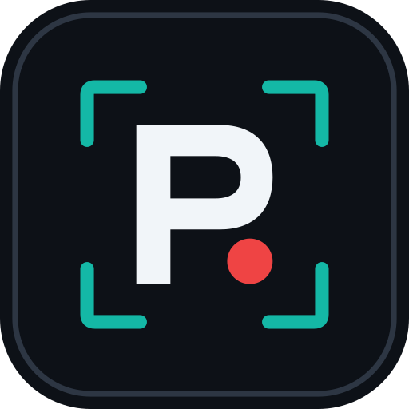
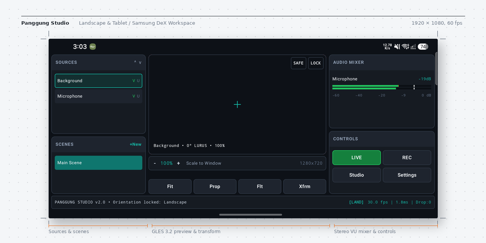
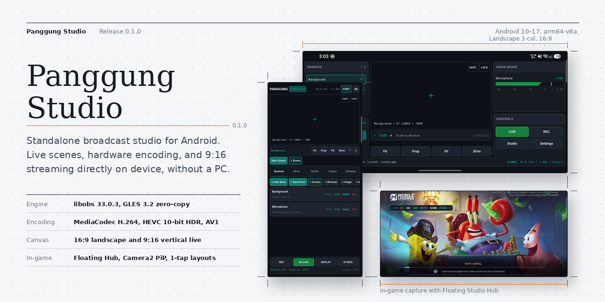

<div align="center">

  <p align="center">
    
  </p>

  <h1>Panggung Studio</h1>

  <p>
    <b>Standalone Live Streaming &amp; Recording Studio for Android</b><br />
    <sub>Powered by libobs 33.0.3 · libobs-gles (GLES 3.2 Zero-Copy) · MediaCodec Hardware Acceleration · Rust Core · Jetpack Compose</sub>
  </p>

  <p>
    
    
    
    
    
    
  </p>

  <p>
    <a href="README.md"><b>English</b></a> &nbsp;•&nbsp;
    <a href="README_ID.md"><b>Bahasa Indonesia</b></a> &nbsp;•&nbsp;
    <a href="../../releases"><b>Download APK</b></a> &nbsp;•&nbsp;
    <a href="CHANGELOG.md"><b>Changelog</b></a> &nbsp;•&nbsp;
    <a href="BUILDING.md"><b>Build Guide</b></a>
  </p>

</div>

---

**Panggung Studio** (`io.panggung.obs`) is a 100% standalone mobile broadcast studio for Android powered by cross-compiled **libobs 33.0.3**, a custom **OpenGL ES 3.2 (`libobs-gles`)** zero-copy compositor, **FFmpeg 8.1.3**, a **Rust (`panggung-core`)** native bridge + `obs-websocket v5` server, and a modern **Jetpack Compose** studio interface designed for Phone Portrait, Compact 3-Column Landscape, and Tablet / Samsung DeX.

It brings full scene compositing, multi-source capture, **TikTok Vertical 9:16 (`720×1280` / `1080×1920`)** & **16:9 Landscape** live streaming, local **Hybrid MP4** recording, 10-bit HDR PQ/HLG, and an **In-Game Floating Studio Hub** (with live Camera PiP drag/resize/rotate/flip and 1-tap layout presets) directly to Android devices — with **zero PC required**.

## Interface Preview

<div align="center">

<p><b>Landscape &amp; Tablet / Samsung DeX</b> — 3-Column Studio Workspace</p>



<br /><br />

<p><b>Phone Portrait &amp; TikTok 9:16 Live</b> — Studio UI + In-Game Floating Hub</p>



</div>

## Features

### Video, 10-bit HDR & Hardware Encoding

| Capability | Details |
| --- | --- |
| **MediaCodec Hardware Encoding** | H.264, HEVC (including Main10 10-bit HDR), AV1, and VP9 with Session Generation IDs, safe recreate-per-attempt fallback, and live bitrate adjustment (`obs_encoder_update`) without dropping active streams. |
| **GLES 3.2 Compositor** | Custom `libobs-gles` backend with `AHardwareBuffer` → `EGLImageKHR` + `EGLSyncKHR` + `samplerExternalOES` support (Camera2 and WebView currently upload via I420/RGBA buffers). |
| **10-bit HDR Pipeline** | Rec. 2100 PQ & HLG compositing with `P010` / `GL_R16F` / `GL_RG16F` / `GL_RGBA16F` render targets and `android_mediacodec_hevc_hdr` hardware encoding (`primaries=bt2020`, `trc=smpte2084`). |
| **Bundled Software Encoders** | Cross-compiled `x264`, `x265 3.6`, and `libaom 3.10.0` (AV1) via **FFmpeg 8.1.3** (`libsrt v1.5.4`, `libxml2 v2.13.5`/DASH, `mbedTLS`). |
| **Dual Orientation Canvas** | Instant switching between **16:9 Landscape** (`1280×720` / `1920×1080`) and **9:16 Vertical Portrait** (`720×1280` / `1080×1920`) for TikTok Live, YouTube Shorts, and Instagram Live. |

### Capture, Audio & In-Game Broadcast

| Capability | Details |
| --- | --- |
| **Android 14–17 Screen + Internal Audio** | Single persistent `MediaProjection` `VirtualDisplay` with proportional aspect-preserving resize (`DisplayManager.DisplayListener` + `onCapturedContentResize` deduplication) and `AudioPlaybackCapture` per-app internal game audio. |
| **Background-Safe Camera2 (Front & Back)** | 1-tap Front ↔ Back camera switching (`HandlerThread` + `AtomicLong` generation + `CountDownLatch` close sync) with combined `CAMERA \| MICROPHONE \| MEDIA_PROJECTION` (`FGS=224`) so the camera stays live while playing games. |
| **In-Game Floating Studio Hub** | Auto-appears when entering a game (`● LIVE` / `● HUB` draggable pill). Expands to 1-tap **`REC`**, **`MIC`**, **`CAM`**, **`LAYOUT`**, **`SCENE`**, and **`STUDIO`**. |
| **In-Game Camera PiP Controls** | Tap **`CAM`** in-game to drag camera position, resize via corner handle (`◢`) or `S`/`M`/`L` presets, flip **`FRONT`/`BACK`**, rotate **`↻ 90°`**, mirror **`⇄ H`** / **`⇅ V`**, and lock with **`✓ DONE`** — all while preserving 100% true aspect ratio. |
| **1-Tap In-Game Layout Presets** | Tap **`LAYOUT`** in the Floating Hub to switch live between **`SPLIT 2`** (Top Camera + Full-Width Fit Game + Bottom TikTok Chat Safe Zone), **`3-SLOT`** (Camera + Game + Bottom Overlay/Chat), **`GAME+PiP`**, and **`FULL CAM`**. |
| **Browser, Media & Experimental I/O** | WebView Browser Source (`window.obsstudio`), FreeType2 text, Image/Media playback, **SpeexDSP 1.2.1** noise suppression + Stereo VU meters (`obs_volmeter_t`), GPU shader pack (`Composite Blur`, `Retro CRT`, `Stroke Glow`, `3D Perspective`, `Luma Threshold Key`, `Digital PTZ`, `Freeze Frame`, `GPU Ring Frame Delay`), plus experimental USB UVC / NDI® (BYOR) scaffolding. |

### Adaptive UI, Remote Control & Thermal Safety

| Capability | Details |
| --- | --- |
| **3-Tier Responsive Workspace** | Seamlessly adapts between **Phone Portrait**, **Compact 3-Column Landscape**, and **Tablet / Samsung DeX Full-Sidebar**, with persistent Orientation Lock (`AUTO` / `PORT` / `LAND`). |
| **Interactive Touch Preview** | Direct canvas drag, pinch-to-zoom, and center-pivot rotation with magnetic `0°/90°/180°/270°` snapping, alignment crosshair, and `Fit` / `Center` / `Flip` / `Reset` controls. |
| **Hardened Remote API & Persistence** | Opt-in `obs-websocket v5` (`:4455`) & Web Remote (`:8080`) — **disabled by default**, localhost-only unless LAN is explicitly enabled, mandatory **SHA-256 challenge-response + token auth**, remote Lua/plugin loading blocked. Full v2 scene collection persistence (scenes, sources, transforms, visibility, lock, audio, filters) auto-saved across restarts. |
| **Thermal Governor & Crash Recovery** | 5-second `PowerManager.getThermalHeadroom` monitoring with automatic live bitrate throttling, Keep-Screen-On, SAF shared-storage recording (`SafFdBridge`), and persistent crash recovery log. |

## Requirements

* **Architecture & OS**: `arm64-v8a`, Android 10+ (API 29+), Target SDK 35 (verified on Android 17).
* **Permissions**: Camera, Microphone, MediaProjection (Screen Capture), and `SYSTEM_ALERT_WINDOW` (Display over other apps, for the In-Game Floating Studio Hub).
* **Dependencies**: Android System WebView (for Browser Source). Hardware HEVC 10-bit HDR and AV1 depend on device SoC capabilities.

## Quick Start

1. **Install**: Build from source following [BUILDING.md](BUILDING.md) and install onto your device:
   ```sh
   adb install --no-streaming -r app/build/outputs/apk/release/app-release.apk
   ```
2. **Add Sources**:
   * Tap **`+ Cam Front`** or **`+ Cam Back`** for facecam / rear camera.
   * Tap **`+ Screen`** → select **Share entire screen** → **Share screen** to capture gameplay + internal game audio.
3. **Go Live (Landscape 16:9 or TikTok Vertical 9:16)**:
   * Configure your RTMP Server URL + Stream Key in the **Output** tab (or connect via `obs-websocket v5` on `:4455`).
   * For **TikTok Live Vertical**, switch video canvas to **`720×1280`** (or **`1080×1920`**) in **Settings**.
   * Tap **`GO LIVE`** and launch your game.
4. **Control Everything In-Game via Floating Studio Hub**:
   * Tap the floating **`● LIVE`** pill → tap **`LAYOUT`** to cycle **`SPLIT 2`** / **`3-SLOT`** / **`GAME+PiP`** / **`FULL CAM`**.
   * Tap **`CAM`** to drag, resize (`◢` or `S`/`M`/`L`), flip **`FRONT`/`BACK`**, rotate **`↻ 90°`**, or mirror **`⇄ H`** / **`⇅ V`** live over your game, then tap **`✓ DONE`** to lock.

## Verified Hardware Results (`SM-S721B` Galaxy S24 FE, Android 17)

| Test Suite | Result | Notes |
| --- | --- | --- |
| **Core & HDR E2E (`tests/e2e_device_test.py`)** | **65 / 65 PASSED** | Includes 10-bit HDR PQ HEVC (`bt2020` / `smpte2084`), Lua 5.4, Replay Buffer, Filters, Multistream |
| **UI Tap & Camera E2E (`tests/ui_tap_e2e_test.py`)** | **12 / 12 PASSED** | All tabs, modals, 1-tap Front/Back switches, 10× rapid autorotate (`0` crashes) |
| **1080p60 HEVC Soak (`tests/stress_test_all.py`)** | **60.0 FPS Locked** | 30s soak, `skipped=0`, `delta_rss = -23.3 MB` (zero leak), `0` crashes/ANRs |
| **TikTok Portrait 9:16 + Mobile Legends Live** | **Verified Live** | `ffprobe`: `h264 720×1280` + `aac`, `FGS=224` (`0` camera disconnects), `SPLIT 2` zero-crop fit |

## Project Structure

```text
panggung-studio/
├── app/                    # Android app (Jetpack Compose UI, Capture, Services, JNI bridge)
├── crates/panggung-core/   # Rust native core (libobs FFI, JNI bindings, obs-websocket v5, Lua 5.4)
├── native/
│   ├── libobs-gles/        # Custom OpenGL ES 3.2 + AHardwareBuffer zero-copy graphics backend
│   └── android-plugins/    # MediaCodec encoder, Android Camera/Screen/Audio/WebView sources
├── plugin-sdk/             # Third-party Android OBS plugin SDK
├── tools/                  # Cross-compilation scripts (FFmpeg, x264, x265, libaom, libsrt, libobs)
├── tests/                  # Automated ADB + WebSocket E2E, UI tap, and stress test suites
├── README.md               # Documentation (English)
├── README_ID.md            # Dokumentasi (Bahasa Indonesia)
├── BUILDING.md             # Build & Test Guide (EN / ID)
└── CHANGELOG.md            # Release notes (EN / ID)
```

## Frequently Asked Questions (FAQ)

### Is Panggung Studio a free open-source OBS alternative for Android?
Yes. Panggung Studio is licensed under **GPL-2.0-or-later** and runs the real cross-compiled **libobs 33.0.3** engine natively on Android (`arm64-v8a`) — giving you scenes, multi-source compositing, hardware MediaCodec encoding, filters, and `obs-websocket v5` without a PC or subscription paywall.

### Can I live stream mobile games in TikTok Vertical 9:16 with facecam?
Yes. Switch the canvas to **`720×1280`** or **`1080×1920`**, add **`+ Cam Front`** / **`+ Cam Back`** and **`+ Screen`**, tap **`GO LIVE`**, and use the in-game **Floating Studio Hub → `LAYOUT`** button to switch between **`SPLIT 2`** (Top Camera + Full-Width Game + Bottom TikTok Chat Safe Zone), **`3-SLOT`**, **`GAME+PiP`**, and **`FULL CAM`** with zero aspect-ratio distortion.

### Does the camera stay active when switching into a game on Android 14–17?
Yes. Panggung Studio combines `CAMERA | MICROPHONE | MEDIA_PROJECTION` (`FGS=224`) in a single Foreground Service so Android 14–17 never disconnects your Front or Back camera when you switch into fullscreen games like Mobile Legends.

### Which streaming protocols and encoders are supported?
RTMP, RTMPS, Multistream RTMP, SRT (`libsrt`), HLS, DASH, RTSP, and NDI® (BYOR). Video encoders include hardware **MediaCodec** (`H.264`, `HEVC`, `HEVC 10-bit HDR PQ/HLG`, `AV1`, `VP9`) and bundled software encoders (`x264`, `x265 3.6`, `libaom 3.10.0`).

## Documentation & License

* [Bahasa Indonesia Documentation (`README_ID.md`)](README_ID.md)
* [Build & Test Guide (`BUILDING.md`)](BUILDING.md)
* [Release Changelog (`CHANGELOG.md`)](CHANGELOG.md)
* [AI / LLM Project Index (`llms.txt`)](llms.txt)

Licensed under **GPL-2.0-or-later** (aligned with upstream `libobs` / OBS Studio).
