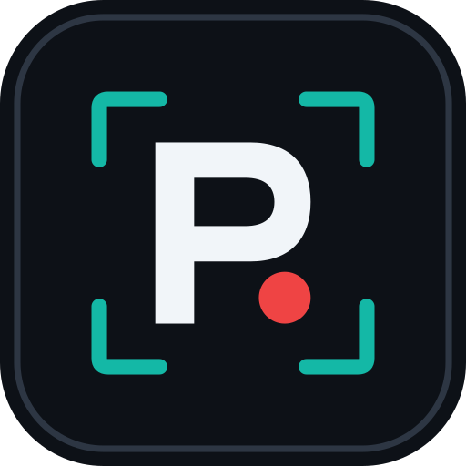
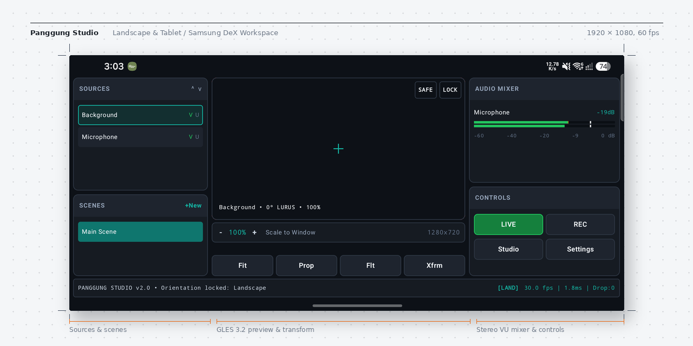
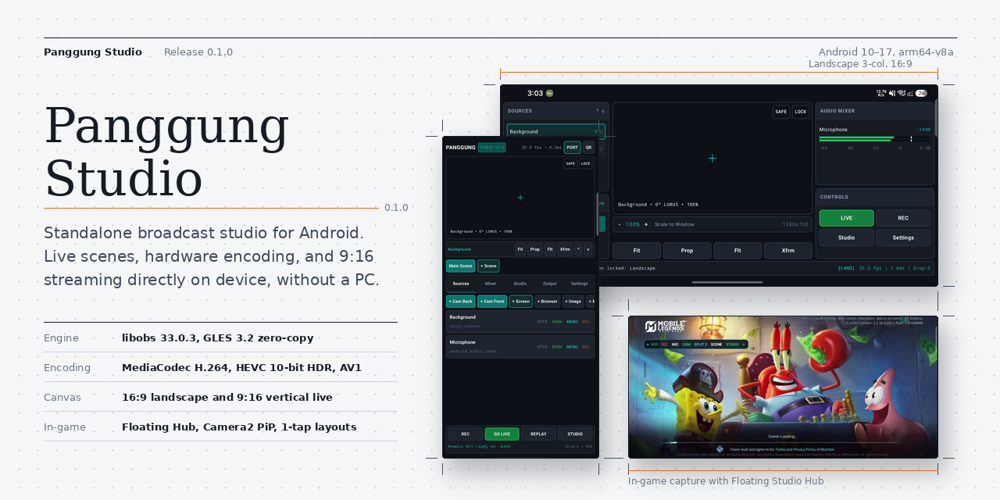

<div align="center">

  <p align="center">
    
  </p>

  <h1>Panggung Studio</h1>

  <p>
    <b>Studio Live Streaming &amp; Screen Recording Standalone untuk Android</b><br />
    <sub>Ditenagai libobs 33.0.3 · libobs-gles (GLES 3.2) · Hardware MediaCodec · libsrt v1.5.4 · Rust Core · Jetpack Compose</sub>
  </p>

  <p>
    
    
    
    
    
    
  </p>

  <p>
    <a href="README.md"><b>English</b></a> &nbsp;•&nbsp;
    <a href="README_ID.md"><b>Bahasa Indonesia</b></a> &nbsp;•&nbsp;
    <a href="#guide"><b>Guide</b></a> &nbsp;•&nbsp;
    <a href="../../releases"><b>Download APK</b></a> &nbsp;•&nbsp;
    <a href="CHANGELOG.md"><b>Catatan Rilis</b></a> &nbsp;•&nbsp;
    <a href="BUILDING.md"><b>Panduan Build</b></a>
  </p>

</div>

---

**Panggung Studio** (`io.panggung.obs`) adalah studio live streaming & rekaman layar Android **100% standalone (tanpa PC)** yang ditenagai **libobs 33.0.3**, compositor **OpenGL ES 3.2 (`libobs-gles`)**, **FFmpeg 8.1.3** + **libsrt v1.5.4**, core **Rust (`panggung-core`)** + server TLS 1.3 `obs-websocket v5`, serta tampilan **Jetpack Compose** adaptif untuk HP Portrait, Landscape 3-Kolom, dan Tablet / Samsung DeX.

Mendukung multi-scene seperti OBS di PC, live **RTMP / RTMPS / SRT terenkripsi / UDP MPEG-TS**, **TikTok Vertikal 9:16** & **Landscape 16:9**, rekaman **Hybrid MP4** lokal, **10-bit HDR PQ/HLG**, serta **Floating Studio Hub** di atas game.

## Pratinjau Antarmuka

<div align="center">

<p><b>Landscape &amp; Tablet / Samsung DeX</b> — Workspace Studio 3-Kolom</p>



<br /><br />

<p><b>HP Portrait &amp; Live TikTok 9:16</b> — Studio UI + Floating Hub In-Game</p>



</div>

---

## Fitur Utama

### Video, 10-bit HDR, SRT & Hardware Encoding

| Kemampuan | Detail |
| --- | --- |
| **MediaCodec Hardware Encoding** | Mendukung H.264, HEVC (termasuk Main10 10-bit HDR), AV1, dan VP9 dengan Session Generation ID, fallback aman per-percobaan, serta pengaturan bitrate live (`obs_encoder_update`) yang dipisahkan antara streaming dan rekaman lokal. |
| **SRT & UDP MPEG-TS Native (`panggung_srt_output`)** | Streaming SRT/MPEG-TS langsung pakai encoder hardware MediaCodec H.264/HEVC + AAC, thread I/O khusus, antrean 128 paket dengan GOP-aware drop, ABR bitrate live & metrik congestion, enkripsi passphrase AES (aman tidak bocor di log), serta blokir otomatis codec AV1/VP9 yang tidak didukung MPEG-TS. |
| **Verifikasi Sertifikat RTMPS (Android 14–17)** | Memuat Root CA dari `/apex/com.android.conscrypt/cacerts` & `/system/etc/security/cacerts` agar live `rtmps://` (YouTube, Facebook, Twitch) terverifikasi TLS secara native. |
| **Compositor GLES 3.2** | Backend kustom `libobs-gles` dengan dukungan `AHardwareBuffer` → `EGLImageKHR` + `EGLSyncKHR` + `samplerExternalOES`. |
| **Pipeline 10-bit HDR** | Komposisi Rec. 2100 PQ & HLG menggunakan `P010` / `GL_R16F` / `GL_RG16F` / `GL_RGBA16F` serta encoder hardware `android_mediacodec_hevc_hdr` (`primaries=bt2020`, `trc=smpte2084`). |
| **Encoder Software Terintegrasi** | Dilengkapi `x264`, `x265 3.6`, dan `libaom 3.10.0` (AV1) melalui **FFmpeg 8.1.3** (`libsrt v1.5.4`, `libxml2 v2.13.5`/DASH, `mbedTLS`). |
| **Canvas Landscape & Portrait 9:16** | Mendukung penuh **Landscape 16:9** (`1280×720` / `1920×1080`) dan **Portrait Vertikal 9:16** (`720×1280` / `1080×1920`) khusus TikTok Live, YouTube Shorts, dan Instagram Live. |

### Capture, Audio & Broadcast di Dalam Game

| Kemampuan | Detail |
| --- | --- |
| **Screen Capture + Audio Internal (Android 14–17)** | `MediaProjection` `VirtualDisplay` persisten dengan resize proporsional otomatis mengikuti rotasi layar (`DisplayManager.DisplayListener`, bebas bar hitam & bebas gepeng) serta tangkapan audio internal game (`AudioPlaybackCapture`). |
| **Camera2 Background-Safe + OIS/EIS** | Ganti kamera Depan ↔ Belakang 1-tap bebas race condition (`HandlerThread` + `AtomicLong` + `CountDownLatch`), stabilisasi hardware **OIS** (prioritas, tanpa crop) / **EIS** aktif dari frame pertama, dan kombinasi FGS **`CAMERA \| MICROPHONE \| MEDIA_PROJECTION` (`FGS=224`)** agar kamera tidak mati saat masuk game. |
| **Floating Studio Hub In-Game** | Muncul otomatis saat keluar studio / masuk game (pil **`● LIVE`** / **`● HUB`** yang bisa digeser). Tap untuk membuka tombol cepat **`REC`**, **`MIC`**, **`CAM`**, **`LAYOUT`**, **`SCENE`**, dan **`STUDIO`**. |
| **Kontrol Kamera PiP Langsung di Game** | Tap **`CAM`** di Floating Hub untuk geser posisi kamera (drag), ubah ukuran lewat sudut **`◢`** atau preset **`S`/`M`/`L`**, ganti **`FRONT`/`BACK`**, putar **`↻ 90°`**, balik **`⇄ H`** / **`⇅ V`**, lalu kunci dengan **`✓ DONE`** (rasio asli tetap utuh 100%). |
| **Preset Layout 1-Tap (Cocok TikTok Gaming)** | Tap **`LAYOUT`** di Floating Hub untuk berpindah cepat antar **`SPLIT 2`** (Atas Kamera + Tengah Game Fit Full-Width + Bawah Ruang Chat/Gift TikTok), **`3-SLOT`** (Kamera + Game + Slot Overlay Bawah), **`GAME+PiP`**, dan **`FULL CAM`**. |
| **Browser, Media & Paket Filter GPU** | WebView Browser Source (`window.obsstudio`), teks FreeType2, pemutar gambar/media, peredam bising **SpeexDSP 1.2.1** + Stereo VU Meter (`obs_volmeter_t`), paket filter GPU (`Composite Blur`, `Retro CRT`, `Stroke Glow`, `3D Perspective`, `Luma Threshold Key`, `Digital PTZ`, `Freeze Frame`, `GPU Ring Frame Delay`), serta fondasi eksperimental USB UVC / NDI® (BYOR). |

### UI Adaptif, Remote TLS 1.3, Auto-Reconnect & Thermal Safety

| Kemampuan | Detail |
| --- | --- |
| **Layout Responsif 3-Mode** | Otomatis menyesuaikan tampilan **HP Portrait**, **Landscape 3-Kolom Ringkas**, dan **Tablet / Samsung DeX Full-Sidebar**, lengkap dengan kunci orientasi **`AUTO` / `PORT` / `LAND`**. |
| **Preview Sentuh Interaktif** | Drag posisi, pinch-to-zoom, dan rotasi poros tengah dengan magnet snap **`0°/90°/180°/270°`**, crosshair tengah, garis bantu **`SAFE`**, kunci **`LOCK`**, serta tombol `Fit`, `↻90`, `⇄`, `Prop`, `Flt`, dan `Xfrm`. |
| **Remote LAN Aman TLS 1.3 (`HTTPS :8080` & `WSS :4455`)** | Server `obs-websocket v5` & Web Remote **nonaktif secara default**, hanya `localhost` kecuali LAN diaktifkan eksplisit, sertifikat ECDSA P-256 persisten lengkap dengan fingerprint SHA-256 & `Copy Cert FP`, wajib **autentikasi SHA-256 challenge-response + token**, pencabutan instan saat `Rotate`, perlindungan Slowloris/flooding, pengamanan path/symlink, dan blokir eksekusi Lua/plugin lewat remote. |
| **IRL Auto-Reconnect & ABR Terpisah** | Reconnect otomatis saat pindah jaringan Wi-Fi ↔ 5G (`registerDefaultNetworkCallback`), bitrate ABR streaming **dipisah total** dari kualitas rekaman lokal (sinyal jelek tidak membuat MP4 lokal buram), dan Wake Lock khusus saat broadcast aktif. |
| **Thermal Governor, Storage Guard & Crash Recovery** | Pemantauan suhu/headroom tiap 5 detik, pengaman memori penuh (blokir rekam jika `< 200 MB`, stop otomatis rapi jika `< 100 MB`), Keep-Screen-On, penyimpanan SAF (`SafFdBridge`), auto-save koleksi scene v2 atomik (`.tmp` + `.bak` + karantina `.corrupt`), keluar aplikasi bersih tanpa crash, dan 16 KB ELF page-aligned. |

---

## Guide

Panduan ini menjelaskan **setiap bagian layar dan fungsi setiap tombol** dengan jelas supaya langsung mudah digunakan.

### 1. Mengenal Bagian Layar (Dari Atas ke Bawah)

| Bagian Layar | Fungsinya |
| --- | --- |
| **Bar Atas (Top Bar)** | Info FPS & kecepatan render GPU, kunci rotasi layar (`AUTO`), dan tombol Remote Control (`QR`). |
| **Layar Preview (Tengah Atas)** | Tampilan hasil akhir yang dilihat penonton. Bisa disentuh langsung: **1 jari** untuk geser posisi, **2 jari** untuk zoom & putar objek. |
| **Bar Aksi Sumber Aktif** | Tombol cepat untuk mengatur sumber/layer yang sedang dipilih (`Fit`, `↻90`, `⇄`, `Prop`, `Flt`, `Xfrm`, `^`, `v`). |
| **Bar Scene** | Daftar susunan layar (misalnya *Main Scene*, *Intro*, *Gameplay*, *Istirahat*). Tap **`+ Scene`** untuk bikin scene baru. |
| **5 Tab Utama** | **`Sources`** (tambah kamera/layar/teks) · **`Mixer`** (volume & mute suara) · **`Studio`** (efek transisi & mode preview) · **`Output`** (URL/Stream Key, encoder, bitrate, rekam) · **`Settings`** (resolusi, orientasi, floating hub). |
| **Bar Broadcast Bawah** | Tombol utama siaran: **`REC`** (rekam), **`GO LIVE`** (mulai live), **`REPLAY`** (simpan momen terakhir), **`STUDIO`** (mode Preview/Program), plus indikator status & frame drop. |

---

### 2. Kamus Fungsi Setiap Tombol

#### Bar Atas & Layar Preview
| Tombol / Tanda | Untuk Apa? |
| --- | --- |
| **`30.0 fps · 1.3ms`** | Menunjukkan kelancaran video (FPS) dan waktu render GPU per frame (makin kecil `ms`-nya makin lancar). |
| **`AUTO` / `PORT` / `LAND`** | Mengunci arah layar aplikasi: `AUTO` (ikut rotasi HP), `PORT` (tegak/portrait), `LAND` (miring/landscape). |
| **`QR`** | Membuka pengaturan **Remote Control**: nyalakan remote dari browser/HP lain, aktifkan **LAN Access (TLS 1.3)**, salin/ganti (**`Rotate`**) token 16 karakter, salin fingerprint sertifikat (**`Copy Cert FP`**), atau scan QR. |
| **`SAFE`** *(pojok kanan atas preview)* | Menampilkan garis bantu **Action Safe (90%)** dan **Title Safe (80%)** supaya teks/kamera tidak ketutup tombol chat TikTok atau YouTube. |
| **`LOCK` / `LOCKED`** *(pojok kanan atas preview)* | Mengunci sentuhan di layar preview agar posisi kamera/overlay tidak sengaja tergeser saat sedang live. |

#### Bar Aksi Sumber Aktif (Tepat di Bawah Preview)
| Tombol | Untuk Apa? |
| --- | --- |
| **`Fit`** | Langsung mengepaskan ukuran sumber yang dipilih memenuhi layar secara proporsional (tidak gepeng). |
| **`↻90`** | Memutar sumber 90° searah jarum jam (berguna jika tampilan kamera/overlay miring). |
| **`⇄`** | Membalik (mirror) tampilan kiri-kanan. |
| **`Prop`** | Mengubah properti sumber (misalnya ganti warna background, ubah tulisan teks, atau ganti link URL Browser Overlay). |
| **`Flt`** | Menambah **Filter** pada sumber (Chroma Key / Green Screen, Warna/Color Grading, Blur, Glow, Retro CRT, Noise Suppression mic, dll). |
| **`Xfrm`** | Mengatur posisi X/Y, skala, dan rotasi dengan angka presisi + tombol Reset. |
| **`^` / `v`** | Memindahkan posisi layer sumber ke **atas** (di depan) atau ke **bawah** (di belakang) layer lain. |

#### Tab `Sources` (Menambah Kamera, Layar, Teks & Overlay)
| Tombol | Untuk Apa? |
| --- | --- |
| **`+ Cam Back`** | Menyalakan / mengganti ke **Kamera Belakang** (otomatis aktifkan stabilisasi OIS/EIS). |
| **`+ Cam Front`** | Menyalakan / mengganti ke **Kamera Depan / Facecam** (1-tap ganti cepat tanpa lag). |
| **`+ Screen`** | Menangkap **Layar HP + Suara Internal Game** (Android 10–17). Setelah tap, pilih *Bagikan seluruh layar / Share entire screen*. |
| **`+ Browser`** | Menambahkan **Browser Overlay** transparan (untuk alert Saweria/Trakteer/StreamElements, live chat, scoreboard). |
| **`+ Image`** | Memilih gambar/logo PNG dari galeri HP sebagai overlay. |
| **`+ Media`** | Memutar file video atau musik lokal (video intro, backsound, dll). |
| **`+ Text`** / **`+ Rich Text`** | Menambahkan tulisan teks atau banner gradien di layar. |
| **`+ Stats HUD`** | Menampilkan info baterai, suhu HP, dan FPS langsung di layar. |
| **`OPEN` / `SHOW` / `MENU` / `DEL`** | Di setiap kartu sumber: `OPEN` untuk memilih sumber, `SHOW`/`HIDE` untuk tampilkan/sembunyikan, `MENU` untuk opsi lengkap (Fit/Lock/Duplikat/Properti), `DEL` untuk menghapus. |

#### Tab `Mixer` (Pengaturan Suara)
| Kontrol | Untuk Apa? |
| --- | --- |
| **Meteran Hijau/Kuning/Merah** | Indikator keras-lemahnya suara secara real-time. Idealnya di area hijau–kuning, jangan terus-terusan merah (pecah). |
| **Slider Volume** | Menaikkan/menurunkan volume Mikrofon, Suara Game, atau Media secara terpisah. |
| **`100%` / `MUTED`** | Tombol cepat 1-tap untuk **membisukan (Mute)** atau menyalakan kembali suara. |
| **`ADV`** | Pengaturan audio lanjutan: Sync Offset (ms) jika suara tidak sinkron dengan gambar, Balance kiri/kanan, Track audio, dan Monitor. |

#### Tab `Studio` & Tombol **`STUDIO`** di Bawah
| Kontrol | Untuk Apa? |
| --- | --- |
| **Transisi (`Fade`, `Cut`, `Swipe`, `Slide`, `Wipe`)** | Memilih efek animasi saat berpindah antar Scene, lengkap dengan durasi (ms). |
| **`FADE TO BLACK`** | Menggelapkan layar siaran secara halus ke hitam (dan mengembalikannya). |
| **`STUDIO` / `STD ON`** | Mengaktifkan **Studio Mode**: Anda bisa mengedit scene di *Preview* tanpa dilihat penonton dulu. Jika sudah siap, tap bar kuning **`CUT → PROGRAM`** (atau **`TRANSITION TO PROGRAM`**) untuk menayangkannya ke penonton. |

#### Tab `Output` & Bar Broadcast Bawah
| Tombol / Kolom | Untuk Apa? |
| --- | --- |
| **Encoder (`HW H.264`, `HW HEVC`, `HW HDR`, `SW x264`)** | Pilih mesin kompresi video. **`HW H.264`** paling aman & kompatibel di semua platform (YouTube/TikTok/Twitch); **`HW HEVC`** lebih tajam di bitrate kecil; **`HW HDR`** untuk 10-bit HDR. |
| **Bitrate (Kbps)** | Kualitas video & kebutuhan internet upload. Saran: `2500–4500` Kbps untuk 720p30, `6000–8000` Kbps untuk 1080p60. |
| **Server URL & Stream Key** | Tempat menempel alamat server (`rtmp://`, `rtmps://`, `srt://`, atau `udp://`) dan kunci stream dari platform live Anda. |
| **`REC` / `START REC` / `PAUSE` / `RESUME` / `STOP REC`** | Merekam video **Hybrid MP4** ke folder `Movies` HP Anda (aman dari corrupt, bisa di-pause, dan otomatis berhenti rapi jika memori `< 100 MB`). |
| **`GO LIVE`** | Memulai / menghentikan live streaming (berubah merah saat live, otomatis reconnect jika sinyal Wi-Fi/5G putus-nyambung). |
| **`REPLAY`** | Menyalakan Replay Buffer untuk menyimpan cuplikan highlight beberapa detik terakhir kapan saja. |

#### Tab `Settings` (Pengaturan)
| Kontrol | Untuk Apa? |
| --- | --- |
| **Canvas (`720p30`, `1080p30`, `1080p60`, `Vertical 720p`)** | Mengatur resolusi & bentuk layar. Pilih **`Vertical 720p`** (`720×1280`) untuk TikTok Live / YouTube Shorts / Reels. |
| **Screen Orientation Lock** | Kunci layar ke `Auto`, `Lock Portrait`, atau `Lock Landscape`. |
| **Floating Studio Hub Popup** | Memunculkan tombol melayang **`● LIVE` / `● HUB`** otomatis saat Anda masuk ke dalam game. |
| **Keep Screen On** | Mencegah layar HP mati/tidur saat sedang siaran. |
| **All Settings (13 Pages)** | Menu pengaturan lengkap ala OBS Desktop (General, Stream, Output, Audio, Video, Hotkeys, Advanced, dll). |
| **Multiview** | Menampilkan semua scene dalam bentuk kotak grid supaya tinggal tap untuk pindah scene. |
| **Save Col / Load Col** | Simpan atau muat ulang susunan scene secara manual (otomatis juga tersimpan aman ke penyimpanan). |

#### Floating Studio Hub (Tombol Melayang di Dalam Game)
Saat Anda keluar dari Panggung Studio dan membuka game, pil kecil **`● LIVE`** / **`● HUB`** muncul di layar:
* **`REC`** — Mulai/stop rekam tanpa keluar dari game.
* **`MIC`** — Cepat mute/unmute mikrofon.
* **`CAM`** — Atur posisi kamera facecam langsung di atas game: geser (drag), tarik sudut **`◢`** atau pilih **`S`/`M`/`L`** untuk ukuran, **`FRONT`/`BACK`** ganti kamera, **`↻ 90°`** putar, **`⇄ H` / `⇅ V`** mirror, lalu **`✓ DONE`** untuk mengunci.
* **`LAYOUT`** — Ganti tata letak 1-tap: **`SPLIT 2`** (Atas Kamera + Tengah Game Penuh + Bawah Ruang Chat TikTok) → **`3-SLOT`** → **`GAME+PiP`** → **`FULL CAM`**.
* **`SCENE`** — Ganti scene langsung dari dalam game.
* **`STUDIO`** — Kembali ke aplikasi Panggung Studio.

---

### 3. Tutorial Cepat Langkah demi Langkah

#### A. Cara Live ke YouTube / Twitch / Facebook (RTMP / RTMPS)
1. Buka tab **`Sources`** → tap **`+ Cam Back`** atau **`+ Cam Front`** (bisa tambah **`+ Image`** logo atau **`+ Browser`** alert).
2. Buka tab **`Output`** → pilih **`HW H.264`**, atur Bitrate (misal `4500` Kbps), tempel **Server URL** (`rtmps://...` atau `rtmp://...`) dan **Stream Key**.
3. Tap **`GO LIVE`** di bawah layar!

#### B. Cara Live TikTok Vertikal (9:16) Sambil Main Game + Facecam
1. Buka tab **`Settings`** → tap **`Vertical 720p`** (`720×1280`) dan pastikan **Floating Studio Hub Popup** dalam posisi ON.
2. Buka tab **`Sources`** → tap **`+ Cam Front`** lalu tap **`+ Screen`** (pilih *Bagikan seluruh layar*).
3. Buka tab **`Output`** → isi Server URL & Stream Key TikTok → tap **`GO LIVE`**.
4. Buka game Anda → tap pil melayang **`● LIVE`** → tap **`LAYOUT`** → pilih **`SPLIT 2`** atau **`GAME+PiP`**.

#### C. Cara Live IRL Outdoor Pakai SRT Terenkripsi (Anti Putus)
1. Buka tab **`Output`** → pilih **`HW H.264`** atau **`HW HEVC`**.
2. Isi **Server URL** dengan alamat SRT Anda, contoh:
   `srt://server-anda.com:9000?mode=caller&latency=200000&passphrase=RahasiaAnda&pbkeylen=16`
3. Tap **`GO LIVE`**. Bitrate streaming akan otomatis menyesuaikan sinyal 4G/5G tanpa merusak kualitas rekaman lokal, dan otomatis menyambung ulang jika jaringan berpindah Wi-Fi ↔ seluler.

#### D. Cara Remote dari HP/Laptop Lain (Web Remote + TLS 1.3)
1. Tap tombol **`QR`** di pojok kanan atas.
2. Nyalakan **Enable Remote Control** (dan aktifkan **Allow LAN Access (TLS 1.3)** jika ingin diakses dari HP/PC lain di Wi-Fi yang sama).
3. Scan QR code atau buka `https://<IP-HP-Anda>:8080` di browser lalu masukkan token 16 karakter. Kapan pun ingin mencabut akses semua perangkat lama, cukup tap **`Rotate`**.

---

## Hasil Verifikasi Hardware Asli (`v0.2.0` di `SM-S721B` Galaxy S24 FE, Android 17)

| Suite Pengujian | Hasil | Bukti Real Device |
| --- | --- | --- |
| **Core & HDR E2E (`tests/e2e_device_test.py`)** | ✅ **64 / 64 LULUS** | `obs-websocket v5`, 10-bit HDR PQ HEVC (`bt2020`/`smpte2084`), Replay Buffer, Filter, Multistream |
| **Barbar Chaos & Security (`tests/barbar_chaos_security_test.py`)** | ✅ **12 / 12 LULUS** | 22/22 `.so` 16KB ELF + `apksigner OK`, rotasi token kick client, 20 Slowloris + 30/30 HTTPS burst, traversal/symlink diblokir, WS fuzz, SRT mid-stream `SIGKILL`, concurrent SRT+Rec dual decode, **A/V sync drift `19.0ms`**, persistensi upgrade, 0 leak/crash |
| **Hardened SRT / RTMPS (`tests/srt_reconnect_e2e_test.py`)** | ✅ **SEMUA LULUS** | Encrypted H.264 & HEVC SRT + full decode, AV1/VP9 ditolak, UI `GO LIVE` → remote `StopStream` zero zombie reconnect, RTMPS valid/invalid CA verify, 0 passphrase leak |
| **UI Tap & Kamera E2E (`tests/ui_tap_e2e_test.py`)** | ✅ **12 / 12 LULUS** | Semua 5 tab, modal, ganti kamera Depan↔Belakang 1-tap, `neon_green_rows=0`, 0 crash |
| **Stress & Soak 1080p60 (`tests/stress_test_all.py`)** | ✅ **7 / 7 LULUS** | 8 source + 5 filter (`56.1fps`), soak 30 detik 1080p60 HEVC (`min_fps=60.0`, `delta_rss=-24.4 MB`, `33.7°C`) |
| **Strict Golden SSIM & Soak (`tests/golden_ssim_test.py`, `tests/soak_test.py`)** | ✅ **LULUS** | `SSIM=0.9995` (wajib baseline eksplisit), `min_fps=30.0`, `peak_growth=+0.0 MB`, `crashes=0` |

## Persyaratan & Struktur Proyek

* **Persyaratan**: `arm64-v8a`, Android 10+ (API 29+), Target SDK 35 (teruji di Android 17), Android System WebView (untuk Browser Source).
* **Izin**: Kamera, Mikrofon, MediaProjection (Tangkapan Layar), Notifikasi, dan `SYSTEM_ALERT_WINDOW` (Floating Studio Hub).

```text
panggung-studio/
├── app/                    # Aplikasi Android (UI Jetpack Compose, Capture, Service, JNI)
├── crates/panggung-core/   # Core Rust native (libobs FFI, JNI, TLS 1.3 obs-websocket v5 & Web Remote)
├── native/
│   ├── libobs-gles/        # Backend grafis OpenGL ES 3.2
│   └── android-plugins/    # Encoder MediaCodec, panggung_srt_output, source Android & 3P shader pack
├── plugin-sdk/             # SDK plugin OBS pihak ketiga untuk Android
├── tools/                  # Skrip cross-compile (FFmpeg, x264, x265, libaom, libsrt, libobs)
├── tests/                  # Suite test otomatis ADB + WebSocket (E2E, chaos/security, UI tap, SSIM, soak)
├── README.md               # Dokumentasi & Guide (English)
├── README_ID.md            # Dokumentasi & Guide (Bahasa Indonesia)
├── BUILDING.md             # Panduan Build & Test (EN / ID)
└── CHANGELOG.md            # Catatan Rilis (EN / ID)
```

## Pertanyaan Umum (FAQ)

### Apakah Panggung Studio adalah aplikasi gratis open-source seperti OBS untuk Android?
Ya. Panggung Studio berlisensi **GPL-2.0-or-later** dan menjalankan engine **libobs 33.0.3** asli secara native di Android (`arm64-v8a`) — lengkap dengan multi-scene, komposisi layer, encoder hardware MediaCodec, filter audio/video, dan `obs-websocket v5` tanpa PC dan tanpa biaya langganan.

### Bisa dipakai live streaming game di TikTok Portrait 9:16 pakai facecam?
Bisa. Ubah canvas ke **`Vertical 720p`** (`720×1280`) atau **`1080×1920`**, tambahkan **`+ Cam Front`** / **`+ Cam Back`** dan **`+ Screen`**, tap **`GO LIVE`**, lalu dari dalam game tap **Floating Studio Hub → `LAYOUT`** untuk berpindah cepat antara **`SPLIT 2`** (Atas Kamera + Tengah Game Fit Full-Width + Bawah Ruang Chat TikTok), **`3-SLOT`**, **`GAME+PiP`**, dan **`FULL CAM`** tanpa gepeng.

### Apakah kamera tetap nyala saat masuk ke dalam game di Android 14–17?
Ya. Panggung Studio menggabungkan Foreground Service `CAMERA | MICROPHONE | MEDIA_PROJECTION` (`FGS=224`) sehingga Android 14–17 tidak memutus kamera depan/belakang saat Anda bermain game layar penuh seperti Mobile Legends.

### Protokol streaming dan encoder apa saja yang didukung?
RTMP, RTMPS (dengan verifikasi Root CA Android 14–17), Multistream RTMP, SRT terenkripsi (`libsrt` via `panggung_srt_output`), UDP MPEG-TS, HLS, DASH, RTSP, dan NDI® (BYOR). Encoder video mencakup hardware **MediaCodec** (`H.264`, `HEVC`, `HEVC 10-bit HDR PQ/HLG`, `AV1`, `VP9`) serta software (`x264`, `x265 3.6`, `libaom 3.10.0`).

## Dokumentasi & Lisensi

* [English Documentation & Guide (`README.md`)](README.md)
* [Panduan Build & Test (`BUILDING.md`)](BUILDING.md)
* [Catatan Rilis (`CHANGELOG.md`)](CHANGELOG.md)
* [Indeks AI / LLM (`llms.txt`)](llms.txt)

Dirilis di bawah lisensi **GPL-2.0-or-later** (mengikuti lisensi upstream `libobs` / OBS Studio).
